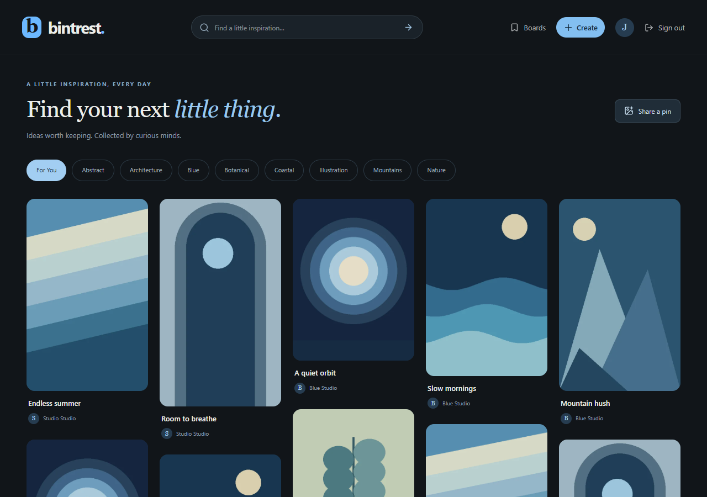
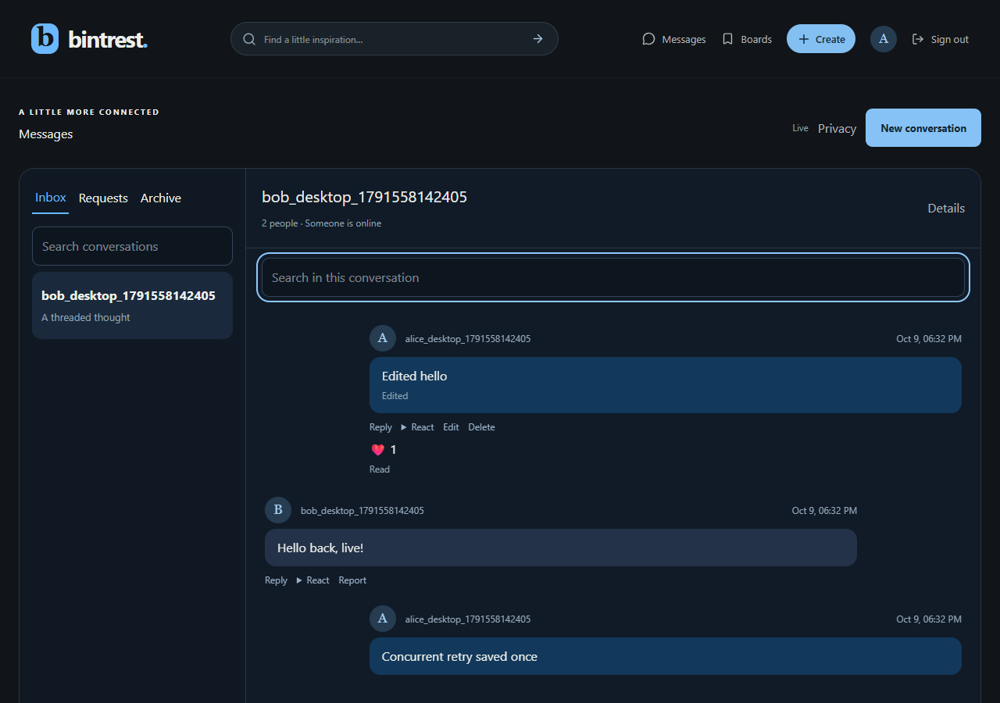

# Behtrest

A blue, dark-themed Pinterest-inspired app, originally built by Amirhossein Ghazanfari Rad at age 13 as a CS50x final project.

[Original video demo](https://youtu.be/EODyZn-WkIM) · [Original README](docs/README-original.md) · [V2 task plan](TASKS.md) · [Verification](docs/VERIFICATION.md) · [Deployment](docs/DEPLOYMENT.md)

## Why I made it

At the time, I wanted a dark theme for Pinterest because using its bright interface was annoying. Blue was my favorite color, so I made my own version with blue accents instead of red. I built it for fun and to put what I learned in CS50x into practice.

Connecting React, a Python API, a database, accounts, image uploads, and comments was part of learning to build a complete application. The original code represents where I was as a programmer at 13, including its unfinished features and mistakes.

## History

- **October 26, 2026, pin details:** completed mobile-first pin details and Discover polish, comments before bounded related pins, download permissions, board picker with safe Undo, share/follow/comment actions, keyboard shortcuts, and initial-HTML social metadata. See [pin detail behavior](docs/PIN-DETAIL.md), [case study](docs/CASE-STUDY.md), and [verification](docs/VERIFICATION.md). These are locally verified features, not a public deployment.

- **October 10, 2026:** renamed the current app to **Behtrest**. The original project was named Bintrest; its original README and source remain preserved.
- **October 10, 2026, community:** added follows and a following feed, activity preferences/unread controls, and a report queue with reversible moderation decisions and audit history.
- **October 26, 2026, discovery and preview:** added a separate guest playground, account-based interests and personalized pin discovery, likes and hide controls, related pins, and a feed-first interface with reduced-motion-aware owl details. The preview and ranking are local; no public deployment is claimed.
- **Original project:** built at age 13 for CS50x. The project folder references the 2022 course; the exact completion date has not been confirmed.
- **October 9, 2026:** revisited the project, initialized a local Git repository, and planned a second version using Django and React.
- **October 9, 2026, V2 foundation:** completed tasks 1–4: V1 reproduction, Django/React setup, data models, and secure account flows.
- **October 9, 2026, V2 collections:** completed tasks 5–8: safe image uploads, paginated feeds and comments, profiles, boards, saves, tags, and search.
- **October 9, 2026, release preparation:** completed task 9's browser automation, accessibility polish, and CI; prepared task 11's portable Docker deployment candidate and verified backup/restore tools. Container runtime verification remains pending because the local Docker engine is unavailable.
- **October 9, 2026, messaging:** added direct and group conversations, message requests, private image sharing, replies/reactions, read receipts, privacy controls, and real-time delivery while keeping the original source intact.

The original README is preserved verbatim in `docs/README-original.md`, including its wording and acknowledgments. Original source remains unchanged in `btrest/`, with Git tag `legacy-v1` preserving its initial snapshot. V2 lives in separate `backend/` and `frontend/` directories.

## V2: current state

For a separate photo-filled playground with one-click guest access and simplified signup, see [Preview setup](docs/PREVIEW.md). It uses its own local database and uploads.

**Stack:** Django 5.2, Channels/ASGI, SQLite, React 19, Vite, TypeScript, and Tailwind CSS. Production uses Redis for live events and temporary presence.

Implemented:

- Registration, login, logout, and current-account lookup using server sessions and CSRF protection.
- Django password validation/hashing and one-use password reset links; development emails print in the Django terminal.
- Custom user, profile, post, comment, board, and saved-post models with migrations and database constraints.
- Django admin and repeatable synthetic demo data.
- Owner-only metadata changes/deletion for existing records, private-board access checks, and persistent API rate limits.
- Responsive account screens and a story page preserving the project's origin.

- Image uploads with previews/progress, content validation, metadata removal, normalized WebP images, and thumbnails.
- Paginated masonry feed, post details and owner controls, and editable comments.
- Profile editing and avatars, public/private boards, board covers, and saved pins.
- Tags, validated source links, pin and people search, and empty/error/retry states.
- 24 repeatable synthetic illustration posts; failed media deletions have a durable retry queue.
- Automated desktop/mobile browser journeys and accessibility checks, plus CI for backend, frontend, and container smoke checks.
- Direct and group messaging, requests, replies, reactions, edits/deletion, pin sharing, private image attachments, search, unread badges, mute/archive, block/report, typing, presence, and sent/delivered/read receipts.
- Opt-in browser notifications, privacy preferences, UUID send retries, and reconnect/history synchronization.
- Following, a following feed, follower lists, and activity notifications with unread controls and preferences.
- Reports, permission-checked moderation, reversible hiding/suspension, and an audit trail. See [community behavior and moderator setup](docs/COMMUNITY.md).
- Local background image screening for public pins and avatars, private previews, retries, and human review/appeals. See [setup and behavior](docs/IMAGE-MODERATION.md).
- Invite-only signup with member referral links, configurable allowances, code revocation/replacement, and audited in-app administrator controls. See [referral settings](docs/REFERRALS.md).
- A separate guest preview with credited sample photography, isolated local data and sessions, a repeatable seed, and simplified signup. See [preview setup and limits](docs/PREVIEW.md).
- Interest onboarding and editable preferences, personalized Discover ranking, related-pin recommendations, idempotent likes, and a private Liked collection. Event weighting, visibility, and ranking limits are documented in [pin discovery](docs/PIN-DISCOVERY.md).
- A refreshed feed-first Discover screen, responsive masonry, keyboard-accessible tag controls, and reduced-motion-aware owl states. See the [UI audit](docs/UI-AUDIT.md) for tested behavior and remaining limits.
- A Docker/Caddy/Uvicorn/Redis deployment candidate, production configuration checks, database readiness, and verified V2 backup/restore commands including private chat images.

Private boards hide their collections; the original pins remain public. Local development uses filesystem media storage. Retry failed deletions with `python backend/manage.py cleanup_media` using the project virtual environment.

### Run V2 (PowerShell)

Prerequisites: Python 3.12 and Node.js 22.12 or newer. Tested on Python 3.12 and Node 24.21.0. From the repository root:

```powershell
./scripts/setup.ps1
```

This creates `.venv`, installs locked dependencies, generates an ignored `backend/.env` with a fresh development secret, and applies migrations to the new V2 database. It does not touch V1 data.

If PowerShell blocks script execution, use the equivalent commands:

```powershell
python -m venv .venv
.\.venv\Scripts\python.exe -m pip install -r backend/requirements-lock.txt
.\.venv\Scripts\python.exe scripts/setup_backend.py
.\.venv\Scripts\python.exe backend/manage.py migrate
cd frontend
npm ci
cd ..
```

Start Django in one terminal:

```powershell
.\.venv\Scripts\python.exe -m uvicorn config.asgi:application --app-dir backend --host 127.0.0.1 --port 8000 --reload --no-access-log
```

Start React in another:

```powershell
cd frontend
npm run dev
```

Open **http://127.0.0.1:5173**. Register a new account; legacy accounts are not imported. Use one browser hostname throughout the session. API requests use the frontend's same-origin proxy.

Optional admin and demo setup:

```powershell
.\.venv\Scripts\python.exe backend/manage.py createsuperuser
.\.venv\Scripts\python.exe backend/manage.py seed_demo
```

Admin is available at `http://127.0.0.1:5173/admin/`. Synthetic demo accounts have unusable passwords by default. Use `manage.py changepassword demo_blue` if you want to sign in as one.

### Verification

```powershell
.\.venv\Scripts\python.exe backend/manage.py check
.\.venv\Scripts\python.exe backend/manage.py makemigrations --check --dry-run
.\.venv\Scripts\python.exe backend/manage.py test accounts collection messaging
cd frontend
npm run format:check
npm run build
npx playwright install chromium
npm run test:e2e
```

Backend tests, Django checks, migration drift, frontend formatting/build, and desktop/mobile browser journeys cover the account/collection and two-person messaging flows. See the verification record for counts and results. Automated axe checks complement manual review.

Community journeys also cover following, activity preferences, reporting, and moderator hide/restore decisions on desktop and mobile.

The browser runner creates a separate temporary V2 database/media directory and uses ports 8001/5174. It never reuses normal preview data. If the browser download is unavailable and Edge is installed, run `$env:BEHTREST_BROWSER_CHANNEL='msedge'` before `npm run test:e2e`. CI uses bundled Chromium. See [verification details](docs/VERIFICATION.md) and [API conventions](docs/API.md).



### Messaging

Open Messages, contact someone from their profile, or share a pin directly into a conversation. See [messaging behavior and operation](docs/MESSAGING.md) for requests, groups, receipts, privacy, retries, and private media cleanup.



## Original version (v1)

**Stack:** React 18, Tailwind CSS, DaisyUI, ejected Create React App, Flask, and SQLite through the CS50 SQL library.

Features include registration/login, JPG/PNG image posts with titles and descriptions, a masonry-style feed, experimental infinite scrolling, post details, comments, and basic profile information.

Known limitations:

- The backend trusts browser-provided identity and does not enforce authenticated ownership.
- Password handling uses a homemade SHA-256 scheme.
- Registration responses and the default avatar URL contain bugs.
- Infinite scrolling repeats the full feed rather than fetching new pages.
- Search, saved posts, full profiles, notifications, and messaging are unfinished.
- API addresses are hardcoded to localhost; error handling and upload validation are incomplete.

V1 is a historical learning prototype and is not ready for public deployment.

## Repository layout

```text
btrest/back/             Original Flask API and local data
btrest/front/            Original React app and build configuration
backend/                 V2 Django application, models, admin, and API
frontend/                V2 React/Vite/TypeScript application
scripts/                 Setup and safe V1 reproduction tools
docs/README-original.md  Unedited original project description
docs/LEGACY.md           V1 reproduction results and visual references
docs/API.md              API contract, authentication, and permissions
docs/VERIFICATION.md     Checks performed and screenshots
docs/DEPLOYMENT.md       HTTPS deployment, storage, backups, recovery, and operations
docs/PREVIEW.md         Isolated local guest playground setup and limitations
docs/PIN-DISCOVERY.md   Pin navigation, feedback events, and ranking behavior
docs/UI-AUDIT.md        Recent responsive UI refinements and verification limits
deploy/                  Dockerfiles, Compose, Caddy, production environment example
.github/workflows/       Backend, frontend, browser, and container verification
TASKS.md                 Proposed V2 tasks and completion criteria
```

The supplied database and generated frontend build remain locally available but are excluded from Git, along with dependencies, Python bytecode, and runtime uploads. The database has not been inspected for personal data.

## Running the original app

V1 dependencies, frontend build, basic API behavior, and account screens were reproduced using a database copy. Full instructions and observed failures are in [docs/LEGACY.md](docs/LEGACY.md). The original image files referenced by the seven posts were not supplied.

Backend, in a virtual environment with `flask`, `flask-cors`, and `cs50` installed:

```powershell
cd btrest/back
python app.py
```

Frontend, in another terminal:

```powershell
cd btrest/front
npm ci
npm start
```

The source expects the API at `http://127.0.0.1:5000` and frontend at `http://localhost:3000`. The backend needs its local database and image directory. Avoid real credentials with V1.

## Planned second version

Preserve the dark/blue identity while rebuilding the backend with Django and modernizing React with Vite. Start with authenticated accounts, safe image posts, comments, pagination, profiles, boards, saves, and search.

Use one backend and one frontend, same-origin session authentication with CSRF protection, and SQLite for initial development. Production storage choices will depend on deployment requirements.

[V2 tasks](TASKS.md) describe the sequence, acceptance criteria, and deferred ideas. Tasks 1–9 are complete. Task 11's Docker deployment candidate passed Linux CI builds, HTTPS, Redis delivery, moderation processing, and restart/persistence checks on October 10, 2026. Task 10's legacy import remains deferred. Nothing has been publicly deployed.

### Deployment candidate

The chosen target is a small Linux server using Docker, Caddy HTTPS, Uvicorn, Redis, persistent SQLite, and filesystem media. [Deployment instructions](docs/DEPLOYMENT.md) include environment generation, SMTP delivery, setup commands, backup/restore drills, monitoring, upgrades, and rollback. The expanded container CI job passed remotely for commit `4813a43`; real hosting, DNS and SMTP delivery remain unconfigured.

## Acknowledgments

Thank you to Harvard for CS50x, the CS50x Rasht team, and Mr. Tavasoli for helping me learn computer science. These acknowledgments carry forward from the original README.
