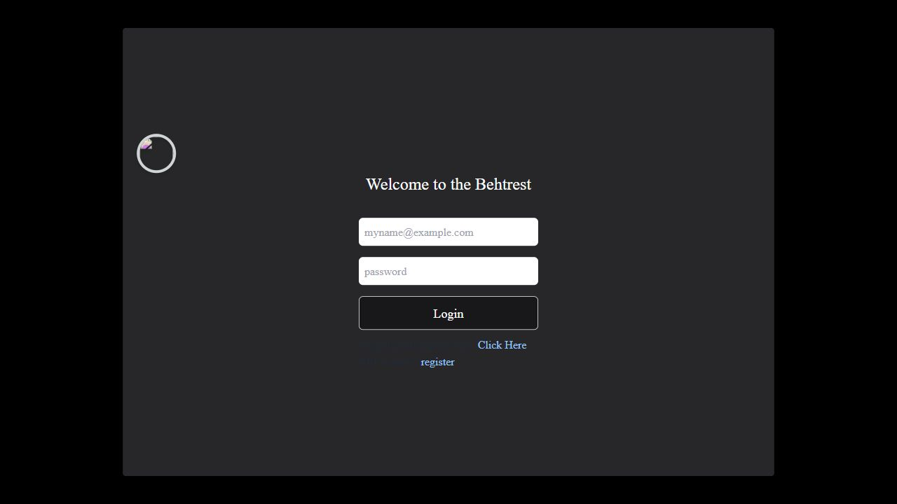
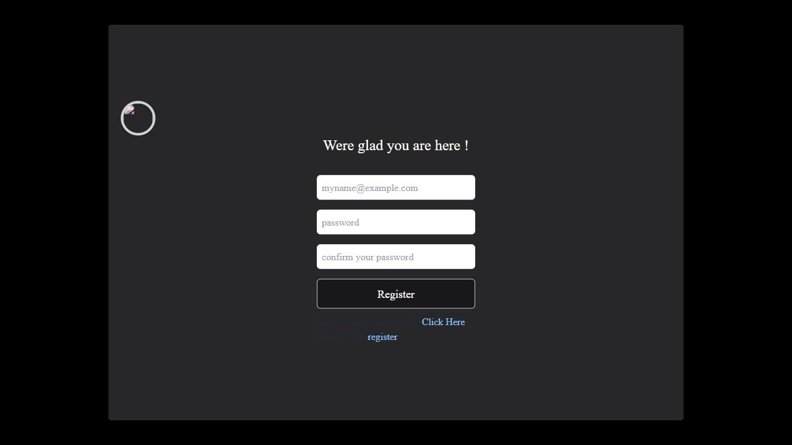

# V1 reproduction — October 9, 2026

The original source is preserved under `btrest/` and tagged `legacy-v1` at commit `b1a6e10`. Its original README remains in `README-original.md`. No V1 application source was edited during tasks 1–4.

## Safe inspection

`scripts/inspect_legacy.py` opens the supplied database in SQLite read-only mode and uses SQLite backup to prepare `.local/legacy-runtime/main.db`. The script reports only schema, aggregate counts, and missing-media counts; it does not print usernames, hashes, comments, or post contents. It copies the Flask source and images into that ignored runtime directory.

The original database checksum was unchanged after inspection. All registration/login checks used a synthetic account in the runtime copy. This is an inventory, not the full import analysis planned in task 10.

| Table | Rows in supplied database | Declared foreign keys |
| --- | ---: | ---: |
| users | 2 | 0 |
| profile | 2 | 0 |
| posts | 7 | 0 |
| comments | 1 | 0 |
| stats | 0 | 0 |
| likes | 0 | 0 |

Only the default avatar was supplied in the image directory. All seven referenced post images are missing. Restoring those images would require their original files; no import can reconstruct them.

## Reproduction commands (PowerShell, repository root)

```powershell
python -m venv .venv-legacy
.\.venv-legacy\Scripts\python.exe -m pip install -r docs/requirements-legacy.txt
python scripts/inspect_legacy.py
.\.venv-legacy\Scripts\python.exe scripts/check_legacy.py
cd btrest/front
npm ci
npm run build
cd ../..
python scripts/serve_legacy.py
```

The static frontend is served at `http://127.0.0.1:3000`. Start the copied API in another terminal:

```powershell
cd .local/legacy-runtime
..\..\.venv-legacy\Scripts\python.exe -m flask --app app run --host 127.0.0.1 --port 5000 --no-debugger --no-reload
```

Running `inspect_legacy.py` again refreshes the runtime database from the original, overwriting changes made only to the runtime copy. Do not use that copy for data you want to retain.

Dependencies installed and the frontend production build succeeded on Python 3.12 and Node 24.21.0. The old frontend emits existing React-hook, unused-import, equality, accessibility, and Browserslist warnings. These remain part of V1. Windows sandbox restrictions required running dependency installation and local listeners outside the sandbox; no workaround changes were made to V1 source.

## Observed behavior

| Check | Result |
| --- | --- |
| Feed API | HTTP 200, existing records returned |
| Synthetic account registration | HTTP 200 with `[{"code":"200"}]`; frontend expects the string `"200"`, so success feedback does not match |
| Synthetic login | HTTP 200, authentication flag true |
| Synthetic profile lookup | Profile exists; avatar URL starts with `http://http://` |
| Default image request | HTTP 200 with incorrect `image/gif` MIME type for JPEG |
| Profile lookup without query ID | HTTP 500 |
| Login/register screens | Render successfully in browser |
| Original image feed | Cannot verify complete visual rendering because referenced image files are absent |
| Ownership/authentication | Source trusts client identity; intentionally not exposed publicly |

The upload/comment UI and missing-image feed were not treated as verified end-to-end flows. Source review confirms hardcoded API URLs, mismatched upload-format advertising, client-side identity, and repeat-full-feed scrolling.

## Visual baseline





The origin story, favorite color, original demo, and acknowledgments are carried forward into the new README and the V2 story page. The exact original completion date remains unconfirmed.
