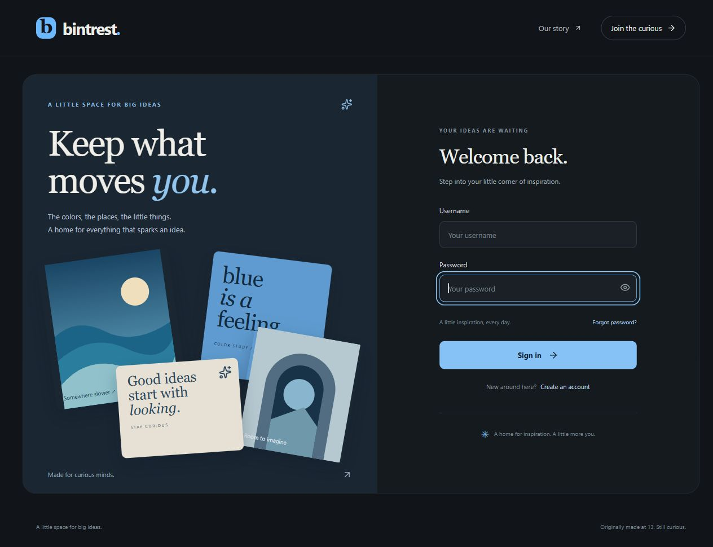
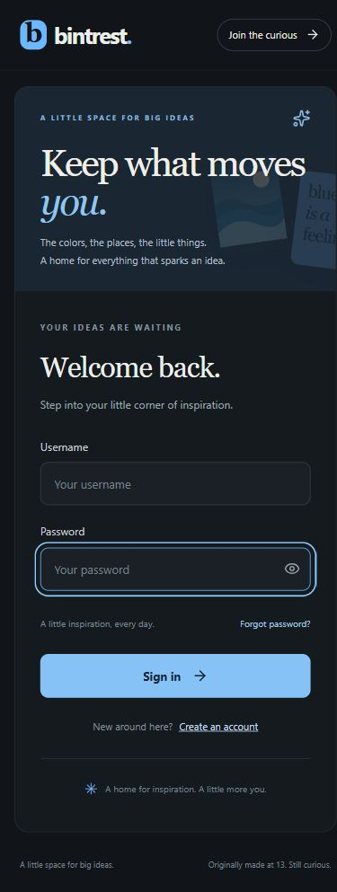
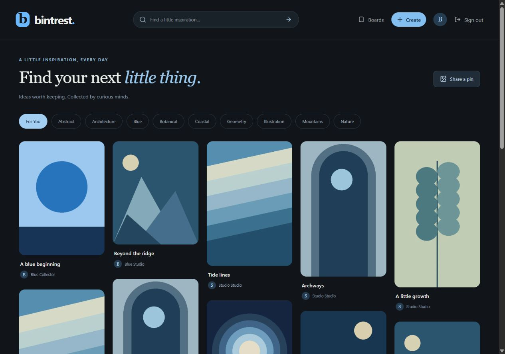
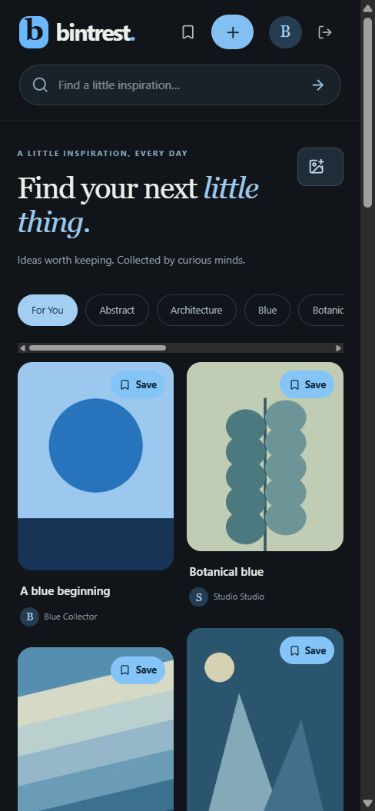
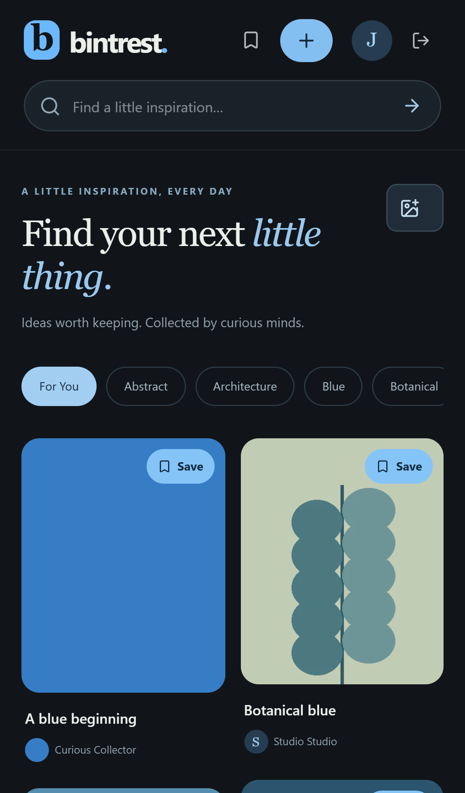
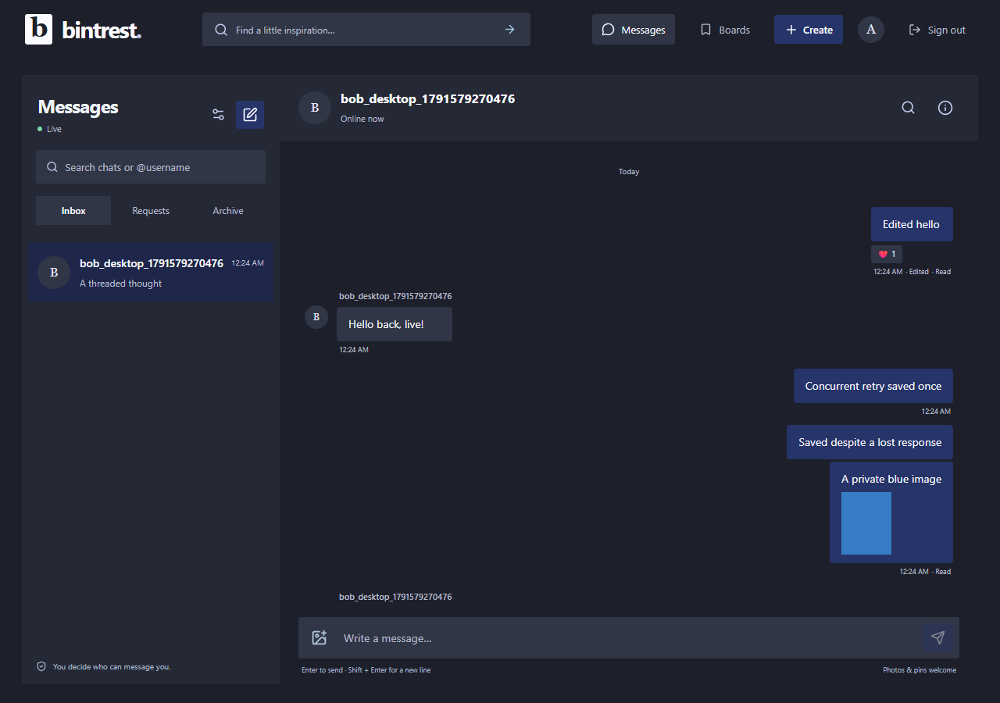

# Tasks 1–4 verification

## Local background image moderation — October 10, 2026

- Committed and pushed the previous Behtrest/community checkpoint to `origin/main` as `78e8db2` before implementation. New moderation work remains local/uncommitted.
- Announced downloads before fetching the CPU runtime (~28 MB of wheels) and pinned NudeNet package (~10.6 MB, containing a 12.2 MB model). The original release download returned HTML and was rejected by size validation; the official PyPI package supplied the model. Its SHA-256 matches the pinned value. Upstream license/provenance are preserved; model binaries and local backup/environment files are excluded from Git.
- Full backend suite: **95 tests passed**. Eleven image-moderation tests cover private previews and owner pagination, approval-only visibility, follower notification timing/idempotence, rejection/appeals, moderator permissions/manual approval, scan failures/backoff, expired leases/stale tokens, avatar replacement/removal races, quarantine cleanup, and invalid outputs/missing models. A 41-test collections/community run and focused image checks passed after final isolation/admin/pagination changes.
- All **six desktop/mobile journeys passed with the real local model and worker enabled**. Both community journeys passed a final focused rerun after explicitly waiting for background approval before checking public following-feed contents. Axe/overflow checks on the tested screens passed. This tests benign fixture processing and application flows, not detector accuracy on a representative nudity dataset.
- Frontend formatting and TypeScript/Vite production build, Django checks/migration drift, Python compilation, diff whitespace checks, and updated Docker Compose syntax validation passed. The recovery drill restored a pending avatar scan and both private files alongside the existing 24 pins/4 boards/24 saves/48 public media files.
- A safe fixture's first local inference took approximately **66 ms**. The running Windows worker used approximately **99 MB RSS while idle** after model loading; these are local observations, not server load/accuracy benchmarks. CPU inference is limited to one thread/one image at a time, with a Docker worker limit of one CPU/1 GB RAM.
- Backed up normal V2 preview data to ignored `backend/backups/pre-image-moderation.zip` (52 verified files), applied the additive migration, enabled public pin/avatar screening, and started the separate local worker. Existing public content is not retroactively scanned, and private chat photos are not automatically screened. Docker model packaging/worker configuration is prepared; container runtime verification remains pending without a local engine.


## Community features and Behtrest rename — October 10, 2026

- Implemented roadmap items 3, 5, and 6: reports and moderation, following and a following feed, and activity notifications/preferences. The current app, package/config names, email labels, operating docs, and deployment examples use Behtrest. Original source/README and the actual GitHub repository URL retain their history. Existing browser drafts and legacy environment variables have compatibility handling.
- The full backend suite passed with **84 tests**. Fourteen community tests cover follow idempotence/counts, self-follow rejection, CSRF/ownership, viewer-scoped pagination, blocks, notification preferences and private-save safeguards, reporting evidence/deduplication, staff permission checks, hiding/restoring pins/comments/messages, private attachment access, audit history, and suspension/session revocation.
- All **six desktop/mobile journeys** pass across the final full run of the four existing account/collection and messaging journeys and the focused run of both community journeys. New coverage checks following/follower lists, following-feed contents, notifications and preferences, marking activity read, report submission, ordinary-user rejection, moderator hide/restore with history, and unfollowing. Axe A/AA and document overflow checks pass on tested following/activity/moderation screens.
- Browser checks found and corrected delayed preference checkbox feedback and the moderation select's accessible name. Preference changes now update immediately, disable while saving, and roll back on errors. Longer chat journeys retain normal five-second assertions and use a 90-second overall journey budget.
- Final frontend formatting and TypeScript/Vite production build passed. Django system checks, migration drift, Python compilation, and diff whitespace checks passed. Desktop/mobile moderation screenshots were visually reviewed.
- A disposable backup/restore drill passed after the schema/name changes: 24 synthetic pins, 4 boards, 24 saves, and 48 media files recovered. Before applying the additive community migrations to normal V2 preview data, a verified 52-file backup was written to ignored `backend/backups/pre-community.zip`. The original database/source remain untouched.
- Local preview runs the new API and reports `behtrest` in its health response. Moderator access requires staff status plus `collection.review_reports`; setup and behavior are documented in [COMMUNITY.md](COMMUNITY.md). No public deployment or remote repository rename was performed.

## Earlier verification

Verified October 9, 2026 on Windows, Python 3.12, and Node 24.21.0.

## Automated checks

```powershell
# From repository root
.\.venv\Scripts\python.exe backend/manage.py check
.\.venv\Scripts\python.exe backend/manage.py makemigrations --check --dry-run
.\.venv\Scripts\python.exe backend/manage.py test accounts collection
cd frontend
npm run build
```

- Django system check: no issues.
- Migration drift: no changes detected.
- Fresh database migrations: applied successfully.
- Backend tests: 29 passed. Each run uses Django's separate test database and temporary image storage.
- React/TypeScript production build: passed.
- Demo command: repeated successfully in tests without duplicating synthetic records; demo accounts have unusable passwords by default.
- Legacy dependencies and build: reproduced; existing warnings documented in `LEGACY.md`.

Coverage includes password hashing/validation, account normalization, profile creation, forged-cookie rejection, owner-only edits/deletes, private-board visibility, JSON/method errors, CSRF enforcement, IP/account/write throttles, unique saves/boards/users, foreign keys, Django admin views, and reset email generation/token consumption/session invalidation.

## Browser checks

- Registered a synthetic local account through React and reached the signed-in home screen.
- Incorrect password produced useful feedback; a valid password signed in.
- Logout returned to login and remained logged out after a full reload.
- Signed-in home displayed the backend health result as connected.
- Password-reset request displayed its generic success state; no external email was sent.
- Reviewed sign-in and registration at desktop and mobile widths (1280 and 390 pixels).
- Saved V1 login/registration and V2 sign-in screenshots in `docs/screenshots/`.

The password-reset confirmation is covered by backend tests; a real user's password was not changed. This first milestone did not include deployment, V1 data import, uploads, or collections.





## Tasks 5–8 verification

Verified October 9, 2026 using the same commands above:

- 47 backend tests passed in the final run, including the repeatable 24-post demo seed.
- Django system checks and migration drift checks passed.
- TypeScript and Vite production build passed after formatting.
- Added tests cover normalized image contents and thumbnails, orientation/metadata removal, invalid/oversized uploads, CSRF and ownership, failed storage/database writes, transaction rollback, durable deletion retries, and avatar replacement/removal.
- Collection tests cover equal-timestamp cursor ordering, inserted-post exclusion, cursor signatures/filter scope, comment ownership, private-board visibility, idempotent saves, board covers, tag limits, source URL validation, search, and public profile privacy.

Browser checks with a synthetic local account confirmed image selection/preview and publication, metadata and source rendering, comment creation, saving into a newly created private board, selecting its cover, profile editing and uploaded-pin display, pin search, and people search. The feed advanced beyond its first page. Reviewed feed layouts at 1280 × 900 and 390 × 844; saved screenshots below. Destructive actions and avatar lifecycle are covered by backend tests.

The browser journey was manual; a repeatable end-to-end test and CI remain task 9. All runtime test accounts, images, and V2 database records are ignored by Git. V1 source and data remain untouched; no import or deployment was performed.





## Tasks 9 and 11 release candidate

Verified October 9, 2026:

- Backend: 54 tests in the final suite. Backup tests round-trip into a separate empty directory, validate image references/checksums, reject missing media and tampered/traversal archives, and refuse overwriting data. Production tests reject weak secrets, HTTP/mismatched origins, wildcard hosts, and incompatible/missing SMTP configuration.
- Both Playwright desktop and mobile journeys passed using installed Edge. Each run starts Django against a new temporary database/media directory on port 8001 and Vite on 5174. Chromium's download endpoint returned a regional 403; no browser download workaround was used. CI installs bundled Chromium.
- Browser coverage: registration, upload preview/publication, comments, native dialog Escape/focus restoration, private-board creation/save/cover, profile and avatar updates, stable multi-page feed without duplicate cards, pin/people search, simulated API failure/retry/no-results, logout/reload, and private-board rejection after logout.
- Axe WCAG 2 A/AA and 2.1 A/AA rules passed on registration, feed, detail, save dialog, board, profile/boards, and people results at desktop/mobile dimensions. The test checks horizontal document overflow and captures screenshots. Automated accessibility checks do not prove complete accessibility.
- Polished low-contrast footnote text, underlined account links, decorative mobile artwork, labels for hidden mobile navigation text, textarea/select focus, selected filters, dialog focus restoration, and profile refresh behavior that previously interrupted avatar editing.
- Frontend formatting, TypeScript/Vite build, Python compilation, Django system checks, and migration drift checks passed.
- Docker Compose configuration validation passed using an ignored synthetic environment. Production `check --deploy --fail-level WARNING` passed, with only two intentionally silenced HSTS policy checks (`security.W005` and `security.W021`), documented in `DEPLOYMENT.md`.
- The disposable recovery script passed fresh migrations → seeding → backup → verified restore, recovering 24 pins, 4 boards, 24 saves, and 48 normalized image/thumbnail files.

CI is configured for backend checks/tests, frontend formatting/build, browser journeys, and container build/HTTPS smoke checks. No repository remote was pushed and no CI run is claimed. Docker Desktop's engine was unavailable locally despite a startup attempt; the container job must run on an available engine before publishing. SMTP credentials, real delivery, DNS, and a live server have not been configured or tested.

Task 9 is complete. Task 11 is prepared for review with container runtime verification pending. Task 10 and public deployment remain deferred; V1 data/source were not changed.




## Messaging verification, October 9, 2026

### Minimal visual redesign, October 10, 2026

Follow-up visual adjustment: restored 10px control radii and 14px panel/image/message radii at the user's request. Replaced pale charcoal/indigo colors with deep navy (`#0b1220`), blue surfaces (`#111f33`, `#1b304a`), saturated action blue (`#1765c1`), and brighter secondary/focus colors. Production build and formatting passed; the live profile and desktop Messages screenshot were reviewed.

All four desktop/mobile browser journeys passed again after this adjustment, including their Axe A/AA contrast and overflow checks.

- Added a shared visual layer based on the requested charcoal (`#1d202a`), off-white (`#fafaff`), indigo (`#273469`), and navy (`#1e2749`) palette. Added lighter charcoal surfaces and pale indigo text/focus colors for readable contrast; brown (`#784a31`) is a restrained illustration accent.
- Removed decorative outlines, shadows, rounded card frames, and pill-shaped controls across profiles, boards, pin details, navigation, search, and Messages. Images and collection frames are square; controls use a 3px radius and message bubbles 4px. Separation comes from tonal surfaces, spacing, and typography. Avatars remain circular.
- Removed the outer chat frame and profile card background, simplified create/account forms, and retained visible keyboard focus and validation indicators.
- The full four-journey desktop/mobile run passed with Axe A/AA and overflow checks. Final desktop frame/form refinements were also checked in a focused rerun. Production build and frontend formatting passed. Screenshots and the live local profile were inspected; no backend or data migration was needed.



### Product polish 1–4, October 10, 2026

- Pin details now include a full-image viewer, copy-link/chat sharing, searchable save destinations, clearer comment metadata and menus, and responsive image/action layouts.
- Profiles and boards use compact headers and searchable pin/board lists. Owners can filter public/private collections, sort saved pins, and enter Organize mode to choose covers or remove saves. Private-board sharing remains restricted.
- Search supports Pins/People, empty-query tag discovery, tag-only results, combined query/tag filters, and newest/oldest ordering. Filter changes have distinct pagination scopes.
- Messages retain text/reply/pin drafts and pending send identifiers in tab-scoped session storage, clear drafts on sign-out, and recover idempotent retries after reload. Unuploaded files are not persisted. Added unread/latest navigation and a paginated shared photos/pins viewer with links back to message history.
- All **70 backend tests passed**, including new checks for private board search, ordering, unread anchors, history seek permissions, and shared-photo join boundaries/deletion. Django checks and migration drift passed; no schema migration was introduced.
- All four desktop/mobile journeys pass across the final full run (both messaging journeys and desktop collection journey) and the focused mobile collection rerun. New browser coverage verifies draft reload, retry after a lost response and reload, shared-photo filters/jump, unread/latest shortcuts, image viewing, board search/organization, profile board search, and tag-only ordering. Axe A/AA and document-overflow checks pass on the tested screens. The final mobile rerun corrected an ambiguous assertion against two synthetic pins with the same title.
- Frontend production build, formatting, and diff whitespace checks passed. Screenshots of pin details, boards, profiles, search, and messaging were reviewed at desktop/mobile dimensions. Tests use disposable databases/media; the normal preview API was restarted to load the new endpoints.

### Messages UX rebuild, October 9, 2026

- Replaced the fixed-height chat with a viewport-sized inbox/conversation workspace. Desktop uses independent inbox/history scrolling; phones show an inbox or conversation, hide bottom navigation while chatting, and keep the composer on screen. Removed an inherited 125px header minimum that initially pushed the phone composer below the viewport.
- Added avatars, timestamps, unread badges, grouped message bubbles, date separators, contextual action menus, image previews, keyboard sending (Enter / Shift+Enter), and a collapsible history search. Message menus open upward near the bottom of the timeline. Existing requests, receipts, replies, reactions, private photos, sharing, group administration, mute/archive, block/report, and retry behavior remain supported.
- Inbox and recipient/invitation pickers use the authenticated people API. Search supports partial usernames, display names, and an optional leading @; selected recipients appear as removable chips. Requests are debounced and stale results are discarded. Selecting a person reuses their existing direct conversation.
- Simplified the feed heading and tag strip, added active desktop navigation and a mobile account menu, and corrected mobile navigation text contrast. The original blue theme and project history remain intact.
- Verified the desktop chat journey and both account/collection journeys in the final full run. The mobile chat journey passed a focused rerun after the header-height fix. All four desktop/mobile journeys therefore pass across the final verification runs. Chat tests now explicitly exercise inbox partial-username lookup, profile contact lookup, group recipient selection, app edit/delete dialogs, and the composer's viewport bounds, alongside the existing live/retry/private-image/accessibility coverage.
- Frontend production build and formatting passed. Screenshots were inspected on desktop and phone dimensions; the real local preview was also reviewed. Browser tests use disposable databases/media, not legacy or normal preview data. No backend schema changes or public deployment were made.

### Original messaging implementation verification

- Final full backend run: **66 tests passed** across accounts, collections, and messaging. New coverage checks requests, idempotent sends, outsider rejection, group admin transfer/join boundaries/removal, blocks, privacy/read-watermark behavior, reactions/replies/edits/tombstones, private image permissions/deletion, and reports/search/archive. ASGI tests reject hostile origins and anonymous cookies and revoke a logged-out session. Five focused WebSocket/backup tests also passed after the final rate-gate/archive-format changes.
- Final full browser run: **4 journeys passed** (existing account/collection flow and two-person messaging, each on desktop/mobile Edge). Chat coverage includes live delivery within the normal five-second assertion timeout, requests/acceptance, private images and anonymous download rejection, edits/reactions/replies, reload recovery, search, groups, blocks/unblocks, and attachment deletion. Three concurrent sends with the same UUID returned the same persisted message; a deliberately lost HTTP response retried without creating a duplicate.
- Axe A/AA checks found no violations on the tested chat screen; no horizontal document overflow at desktop/mobile sizes. Screenshots were visually inspected. The Messages icon remains visible when mobile navigation text is hidden.
- Django checks and migration drift passed, frontend formatting/TypeScript/Vite production build passed, and Python compilation passed. The disposable backup drill passed with format-2 archive support. A dedicated test restored private chat media and rejected a missing private-media reference.
- Applied the additive messaging migration to the local V2 preview and switched port 8000 to Uvicorn; its authenticated WebSocket connected successfully. Legacy data was untouched. Browser tests still use separate temporary data on ports 8001/5174.
- Prepared Redis/Uvicorn/Caddy routing and private storage/cleanup/recovery documentation. Updated Compose syntax validation and production security checks passed with an ignored synthetic environment that was then removed. Redis container delivery and HTTPS runtime checks remain unverified locally because the Docker engine is unavailable. Browser notification UI is opt-in; actual operating-system notification rendering is not part of the headless journey. No public deployment was performed.
